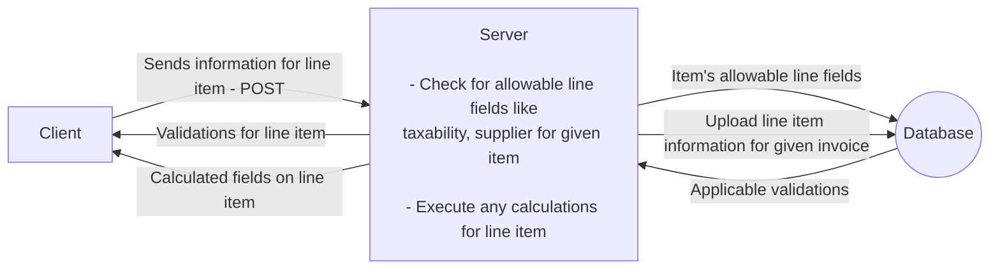

# 1. Original draft

The first draft, transcribed as written. See [2-simplified.md](2-simplified.md) for the revised version.

## Requirements and features

**Functional requirements**
- Enter in variety of different items into an invoice document
- Accept invoices directly from suppliers that integrate with other WD services
- Calculate tax on invoice totals

**Non-functional requirements**
- Low latency of invoice submissions to suppliers
- Processing for calculations, edits, submits must scale from 1-1000's items

**Features**
- Create an invoice
- Create line items on invoice document - create drawing
- Create WD invoice from external suppliers' into invoice queue - adding
  - New UI integration invoice queue
  - Updated logic for handling external invoices at API gateway
  - New API endpoint
  - Database scaling for incrementally larger volumes of invoices and line items stored
  - Updated logic for vetting and conversion of external invoice data to WD-specific formats
  - Updated set of validations that prevent incompatible invoice information getting logged into database and UI
- Tax calculation on invoice

## Diagram

