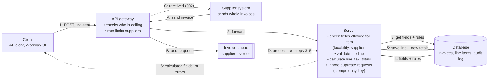

# 2. Simplified version

The original draft with the review applied, at the same level of detail. Steps 1–6: a clerk adds one line and gets results right away. Steps A–D: a supplier sends a full invoice, gets a receipt, and it's processed in the background.

Solid arrows are requests. Dashed arrows are responses.
