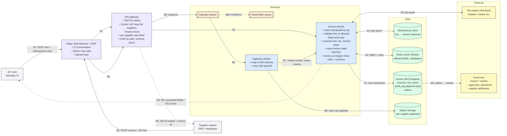
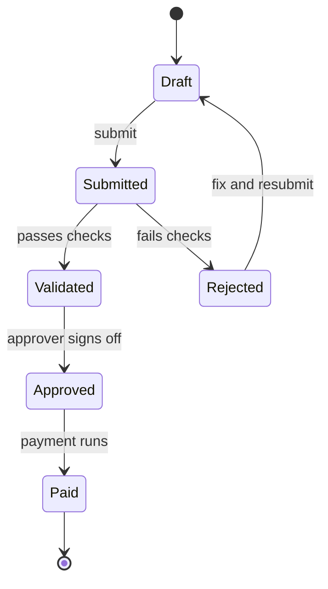

# 3. Interview version

The full design, at the level expected in a technical PM interview at a company like Stripe.

**Assumed scale (confirm with the interviewer):** about 500K invoices a day, 20 lines on average (up to 5,000), and a peak of about 300 line writes per second. p99 line validation under 500 ms. No duplicate or mis-totaled invoices. These numbers are examples to show the kind of assumptions to state, not real Workday figures.

## Architecture

Flow A (steps A1–A9): an AP clerk adds a line, synchronously. Flow B (steps B1–B7): a supplier sends an invoice, asynchronously. Dashed arrows are responses or failure paths.

## Flow A: AP clerk adds a line (sync)

| Step | What happens |
|---|---|
| A1 | `POST /invoices/{id}/lines` with an `Idempotency-Key` header |
| A2 | Edge: TLS, WAF, load balancing |
| A3 | Gateway: SSO auth, tenant check, route to the invoice service |
| A4 | Key seen before? Return the stored response instead of writing again |
| A5 | Load allowed fields and rules (from the database on a cache miss) |
| A6 | Get a tax quote for the line |
| A7 | One transaction: the line, new invoice totals, an audit row, and an outbox event |
| A8 | `201` with computed fields, or `422` with field errors |
| A9 | Outbox relay publishes `invoice.updated` |

## Flow B: supplier sends an invoice (async)

| Step | What happens |
|---|---|
| B1 | `POST /v1/invoices` with the supplier's API key and an `Idempotency-Key` |
| B2 | Edge: TLS, WAF, load balancing |
| B3 | Gateway: auth, per-supplier rate limit, enqueue |
| B4 | `202 Accepted` with an invoice id, right away |
| B5 | Worker pulls the message |
| B6 | Save the raw payload for audit and replay |
| B7 | Map to the WD schema and call the invoice service (same checks as A4–A9) |

Messages that fail repeatedly go to the dead-letter queue for review. The supplier learns the outcome through a webhook (`invoice.validated` or `invoice.rejected`).

## Invoice state machine

- Only Draft is editable.
- Each transition writes an audit row and emits an event.
- The invoice service enforces transitions, not the UI.

## Key decisions and trade-offs

| Decision | Why |
|---|---|
| Sync for clerks, queue for suppliers | Supplier bursts can't slow down the UI |
| Idempotency key on every write | Retries never create duplicate invoices |
| Postgres, not NoSQL | The line, totals, and audit row must commit together |
| Money as integer minor units | No floating-point errors, and one documented rounding rule |
| Outbox pattern | The database write and the published event can't disagree |
| Cache rules, not invoices | Rules are read often and change rarely |

## Cloud products for each component

| Component | GCP | AWS |
|---|---|---|
| Edge | Cloud Load Balancing, Cloud Armor | CloudFront, AWS WAF, Shield |
| API gateway | Apigee or API Gateway | Amazon API Gateway |
| Invoice service, worker | Cloud Run or GKE | ECS on Fargate, or Lambda |
| Ingestion queue + DLQ | Pub/Sub with dead-letter topic | SQS with dead-letter queue |
| Invoice lifecycle workflow | Workflows | Step Functions |
| Invoice DB | Cloud SQL for PostgreSQL or AlloyDB | Aurora PostgreSQL |
| Idempotency store | Firestore or Memorystore | DynamoDB |
| Rules cache | Memorystore for Redis | ElastiCache for Redis |
| Object storage | Cloud Storage | S3 |
| Event bus | Pub/Sub or Eventarc | EventBridge or SNS |
| Secrets and keys | Secret Manager, Cloud KMS | Secrets Manager, KMS |
